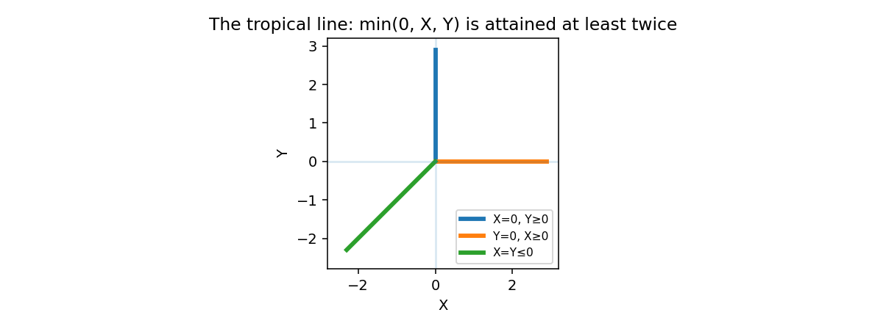

# Arithmetic Without Addition · Lab

**Higher Math for the Impatient**  
*A computational companion to* **Arithmetic Without Addition: From the Field with One Element to Tropical Geometry**

**Mirco A. Mannucci** · HoloMathics, LLC · mirco@holomathics.com  
October 2026 · Research / educational companion · Version 0.1.0

> **Central experiment:** Remove addition, change it, or let algebraic geometry degenerate. What structure survives?



This is **not** a tutorial on basic Python, nor an attempt to implement a universal "field with one element." It is six compact, **executable investigations** of graduate-level mathematics. Each notebook contains motivation, a theorem-level insight, exact computations, visualization where useful, and challenges that go beyond rote arithmetic.

## Start here

- **No SageMath required.** The default implementation uses Python 3.10+, SymPy, NumPy, Matplotlib and NetworkX.
- From a fresh checkout:

```bash
python -m venv .venv
source .venv/bin/activate  # Windows PowerShell: .venv\Scripts\Activate.ps1
python -m pip install -e '.[test]'
jupyter lab
```

Navigate to `notebooks/01_geometry_at_q1.ipynb`. To execute the entire collection from a terminal:

```bash
python scripts/run_notebooks.py
pytest -q
```

Both commands are included in the GitHub Actions workflow.

## The six experiments

| Notebook | Central question | Mathematical punchline |
|---|---|---|
| [01 · Geometry at q=1](notebooks/01_geometry_at_q1.ipynb) | Why do finite-field Grassmannians remember subsets? | Schubert cells, Gaussian binomials, Bruhat order, Weyl groups, the Hecke relation at q=1 |
| [02 · Toric skeletons](notebooks/02_toric_skeletons.ipynb) | How can lattice generators encode a singular variety? | The quadratic cone, binomial relations, the cusp and normalization |
| [03 · Tropical shadows](notebooks/03_tropical_shadows.ipynb) | How can slopes predict valuations of algebraic roots? | Newton polygons, tropical lines, tropical prevarieties versus tropical varieties |
| [04 · Gröbner degeneration](notebooks/04_groebner_degeneration.ipynb) | Why must we study an entire ideal, not just its displayed generators? | Gröbner bases, standard monomials, the flat family `xy=t` |
| [05 · Curves becoming graphs](notebooks/05_curves_to_graphs.ipynb) | How can a graph loop remember genus? | Degeneration of elliptic curves, nodal dual graphs, arithmetic genus |
| [06 · Absolute arithmetic](notebooks/06_absolute_arithmetic.ipynb) | Can rational-point counts be recovered from Frobenius? | Elliptic zeta functions, extension counts, and what q→1 cannot mean |

### Connection to the booklet

The manuscript used for this initial release is included as [`booklet/Arithmetic_Without_Addition_Third_Draft.pdf`](booklet/Arithmetic_Without_Addition_Third_Draft.pdf). It is a **draft snapshot**, not a claim that a future final edition has been published. The notebooks reinforce Chapters 2–7; they can be read independently, but the booklet supplies the continuous mathematical argument.

### A bridge to *Hecke Algebras*

Experiment 01 links the two *Higher Math for the Impatient* titles. Bruhat cells in complete flag varieties are indexed by permutations. The finite-field count is the Poincaré polynomial `Σ q^{length(w)}`, while the Iwahori–Hecke relation `T_s²=(q−1)T_s+q` specializes formally to the Coxeter relation at `q=1`. This is suggestive arithmetic geometry, **not** a general identification of schemes over a literal one-element field.

## Verification and scope

- The finite-field enumeration notebooks use **prime fields** for RREF computation (not general prime powers). Gaussian polynomial formulas apply to prime powers.
- The toric binomial-relation finder searches within a **bounded coefficient range**, and is *not* a general toric-ideal engine.
- Newton-polygon root valuations are mathematically non-Archimedean; real numerical root sizes are **only illustrative**.
- The tropical generator counterexample intentionally shows why arbitrary generating sets are insufficient.
- The elliptic-count experiment uses a smooth curve over **odd characteristic** and its explicit quadratic extension, not an all-characteristic point-counting engine.
- Several phenomena are demonstrated on carefully chosen examples. This repo does not claim to implement general tropical schemes, complete $\mathbb F_1$ geometry, or arbitrary Gröbner fans.

## Repository structure

```text
notebooks/        six teaching/research notebooks
awa_lab/          small, reusable exact-computation modules
assets/           figures generated for this companion
booklet/          current third-draft reference snapshot
scripts/          run all notebooks, generate cover figure
tests/            unit and mathematical invariance tests
.github/workflows automated checks
```

## Further reading

- W. Fulton, *Introduction to Toric Varieties* (1993).
- D. Cox, J. Little, and H. Schenck, *Toric Varieties* (2011).
- D. Maclagan and B. Sturmfels, *Introduction to Tropical Geometry* (2015).
- A. Deitmar, *Schemes over F1* (2005).
- A. Connes and C. Consani, *On the notion of geometry over F1* (2011).
- B. Sturmfels, *Gröbner Bases and Convex Polytopes* (1996).
- R. Hartshorne, *Algebraic Geometry* (1977).

These sources are referenced for mathematical context, not copied into this repository.

## Authorship and rights

Copyright © 2026 **Mirco A. Mannucci / HoloMathics, LLC**. All rights reserved pending an explicit choice of a public software license. Public visibility on GitHub alone does **not** grant an open-source license. See [LICENSE.md](LICENSE.md).

Contributions and corrections can be proposed through GitHub issues and pull requests once the repo is published. Mathematical precision takes priority over visual spectacle.
